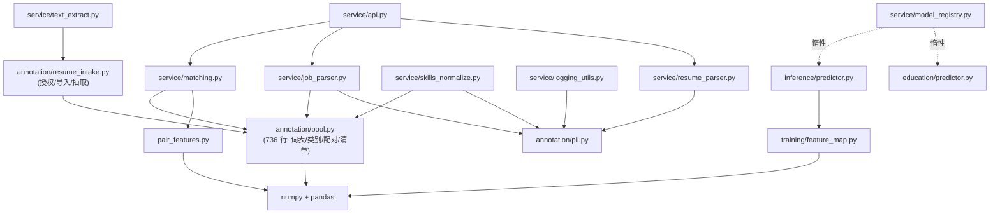

# Phase5-1A 现状审计（基线 `0225fcb`，重构前）

> 本文件记录**重构开始前**的真实依赖与问题清单，作为对比基准。
> 重构后的目标结构见 `phase5-1a-target-state.md`，依赖规则见 `phase5-1a-dependency-rules.md`。
> 证据文件：`reports/phase5-1a/dependency-graph.json`（实测导入图）、
> `reports/phase5-1a/runtime-deps.json`（隔离进程实测第三方库加载）。

## 1. 审计范围

- 源码：`src/job_matching/`（annotation / education / evaluation / independent_eval /
  inference / models / service / training 与顶层模块）
- 脚本：`scripts/`（data_audit / data_pipeline / education_training / model_training /
  phase4_3a / phase4_3a_2 / phase5_1 / phase5_1r）
- 测试：`tests/`（data_pipeline / education_training / environment / fixtures /
  model_training / phase4_3a / phase5_1 / phase5_1r）
- 配置与环境：`configs/`、`environment.yml`、`.gitignore`
- 文档：`docs/`、`reports/`

## 2. 重构前依赖关系（实测）

### 2.1 业务服务层反向依赖研究标注层（核心问题）

| 业务模块 | 引入的研究标注符号 | 连带加载 |
|---|---|---|
| `service/matching.py` | `annotation.pool.classify_job_category` | numpy + pandas |
| `service/job_parser.py` | `annotation.pool.classify_job_category / preferred_segment`、`annotation.pii.mask_matches` | numpy + pandas |
| `service/skills_normalize.py` | `annotation.pool.SKILL_LEXICON`、`annotation.pii.mask_matches` | numpy + pandas |
| `service/resume_parser.py` | `annotation.pii.detect_pii / mask_matches` | pandas |
| `service/logging_utils.py` | `annotation.pii.mask_matches` | pandas |
| `service/text_extract.py` | `annotation.resume_intake.extract_text / ResumeIntakeError` | pandas（经 pool）+ 依赖研究导入链 |

`annotation/pool.py`（736 行）同时承载：数据源登记、技能词表、岗位类别、经验/学历启发式、
简历导入、合成样本、配对生成、清单输出——研究数据工程与**纯业务规则**混在一处，
是上述反向依赖的根因。

### 2.2 运行时依赖（隔离进程实测，重构前）

- `import job_matching.service.api` 实际加载：`numpy`、`pandas`、`pydantic`、`yaml`
  （pandas 完全来自 `annotation.pool` 链，与业务推理无关）。
- `service/explanations.py` / `service/matching.py` 只使用 `pair_features.title_tokens`
  （纯文本函数），却因此引入 pandas。
- torch / sklearn **不在**导入期加载（`model_registry` 对 `inference.predictor`、
  `education.predictor` 采用惰性导入），GPU 环境不是业务 API 的必要条件。

### 2.3 其它跨层关系

- `independent_eval/dataset.py` → `annotation.freeze`（研究侧内部，允许）。
- `annotation/resume_intake.py` → `annotation/pool.detect_language`（研究侧内部）。

## 3. 问题清单（含影响范围与最小调整方案）

| # | 问题 | 影响范围 | 最小调整方案 | 优先级 |
|---|---|---|---|---|
| P-01 | `tests/phase5_1r/run_all.py` 按**类名前缀**推断分组：`test_r5_metrics_input` 的类名为 `R9*`、`test_r6_e2e_chains` 的类名为 `ChainB*/ChainC*`，导致 R5/R6 被记为 `R9`/`R?`，正式分组只汇总 R1–R4 | 测试报告可信度、按组执行、CI 门禁 | 分组改由 `TEST_MODULES` 注册表决定（按加载模块归属），类名解耦 | P0 |
| P-02 | 运行器允许"执行 0 项测试仍返回成功" | 假 PASS 风险 | 收集/执行为 0 一律报错并返回非零退出码 | P0 |
| P-03 | 部分组运行会覆盖正式全量报告 | 历史报告被部分结果覆盖 | 部分运行写 `test-results-<GROUP>.json`，仅全量写 `test-results.json` | P0 |
| P-04 | 报告无聚合一致性校验、无环境/commit 元信息 | 结果与报告不一致无法发现 | 增加 `sum(groups)==totals` 断言 + 环境元信息 | P0 |
| P-05 | 业务服务层依赖研究标注层（§2.1） | 分层混乱、被迫加载 pandas、研究改动波及业务 | 纯规则下沉 `job_matching.domain`，文档抽取下沉 `job_matching.infra`，旧导入路径保留 re-export | P1 |
| P-06 | 技能边界匹配逻辑两处实现（`annotation/pool._SKILL_RES` 与 `service/skills_normalize._boundary_regex`） | Java/JavaScript 等判定口径可能漂移 | 统一为 `domain.skills_lexicon.boundary_regex` | P1 |
| P-07 | PII 能力位于研究层，且"掩码"与"匿名化"边界未在文档口径上区分 | 隐私表述风险 | 下沉 `domain/pii_masking`，文档明确掩码 ≠ 不可逆匿名化 | P1 |
| P-08 | 运行参数散落常量（`api.py`/`text_extract.py`/`model_registry.py`），无类型化配置 | 部署/测试替换困难 | `service/settings.py` 类型化配置 + 环境变量覆盖，兼容输出旧 config 键 | P1 |
| P-09 | 模型加载失败分类过粗：旧 scikit-learn 反序列化失败被归入"文件损坏/加载失败" | A4 无法准确登记环境问题 | `classify_load_failure()`：env_incompatible / artifact_corrupt / artifact_missing 三分类，兼容旧错误码 | P1 |
| P-10 | `verify_freeze()` 只校验清单列出的文件哈希：manifest 元数据、清单外文件、路径歧义均不可见 | 冻结完整性能力缺口 | 独立只读检查器 `check_artifact_integrity.py`（规范化摘要 + 清单外文件 + 路径歧义），明确哈希≠签名 | P1 |
| P-11 | `environment.yml` 未声明服务依赖（FastAPI/Pydantic/HTTPX/Uvicorn/PyMuPDF） | 服务不可复现 | 保留历史训练环境；新增 serving / legacy / test 三份清单 | P1 |
| P-12 | 无 CI | 无自动化门禁 | 最小 GitHub Actions（无 GPU、无真实数据） | P2 |
| P-13 | `reports/phase5-1r/` 缺 acceptance / defect-register / fix-summary | 交付闭环缺口 | 依据真实测试与缺陷记录生成（不得编造） | P2 |

## 4. 明确不重构的项（记录为"暂不实施"）

| 项 | 原因 |
|---|---|
| 把 `service/` 重命名为 `application/` 并引入用例类 | 现有 service 模块已按用例组织（`resume_parser`/`job_parser`/`matching`/`explanations`），重命名收益低于 API/测试迁移风险 |
| 为每个函数建立 Protocol/Port | 与当前复杂度不匹配；仅保留既有 `Services` 容器与 `ModelRegistry` 可替换点 |
| FastAPI Lifespan 重写服务生命周期 | 当前惰性注册 + 模型加载缓存已被 R6 链路 C 测试锁定（`load_only_on_init_or_cache_invalidation`），改为 lifespan 需重写大量测试，收益有限 |
| 合并 `annotation/pool.py` 的数据工程口径经验解析与 `service/requirements.py` 的业务口径 | 两者语义**刻意不同**（数据工程启发式 vs 业务资格约束），合并会造成语义冲突；改为文档化边界 |
| 迁移测试到 pytest | 现有 stdlib unittest 体系稳定，迁移无质量收益 |
| 重训/转换旧 checkpoint 以消除环境不兼容 | 禁止改动历史训练成果；用 Legacy 兼容环境解决 |

## 5. 重构前依赖图（简化）

