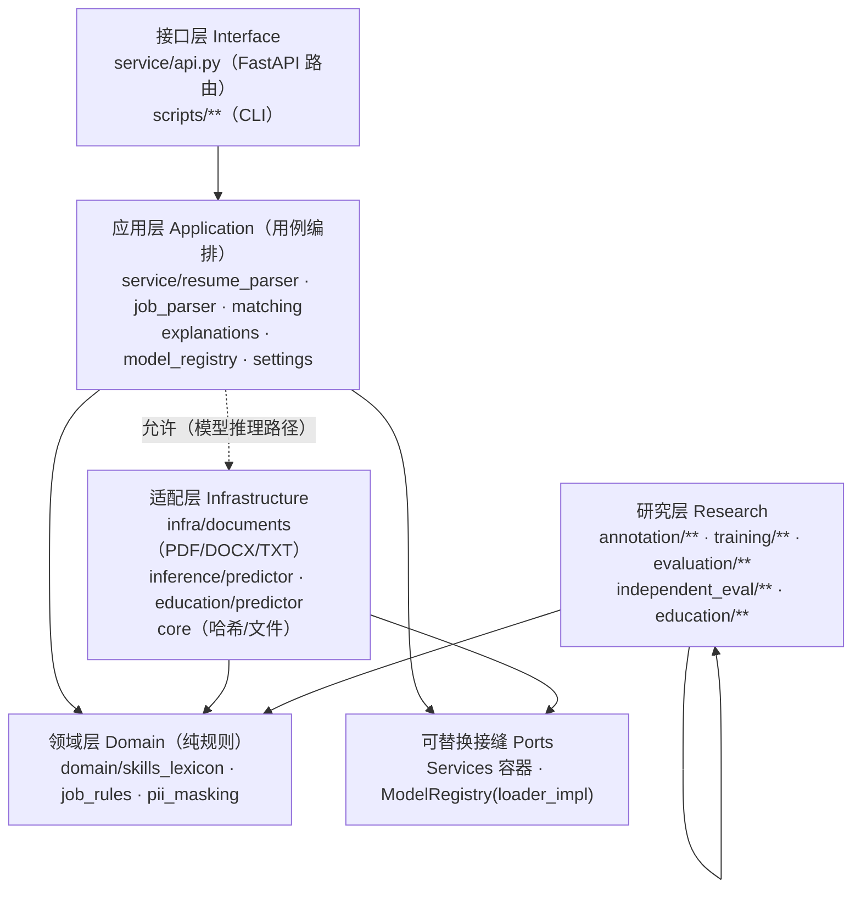

# Phase5-1A 目标架构（模块化单体 · 简化 Clean Architecture）

> 现状审计见 `phase5-1a-current-state.md`；强制依赖规则见 `phase5-1a-dependency-rules.md`。
> 本仓库采用**渐进式**重构后的实际结构，不追求教条式分层。

## 1. 分层与依赖方向

依赖规则（硬约束）：

1. `domain` 不依赖 FastAPI / Pydantic / Pandas / NumPy / PyTorch / sklearn，不访问文件系统；
2. `service`（应用/接口）不得导入 `annotation`（研究标注层）；
3. 研究层可以依赖 `domain`，反向禁止；
4. `infra` 只做外部格式/外部系统适配，不含业务规则；
5. 历史模型训练特征语义由 `training/feature_map.py + configs/feature_policy.yaml` 冻结，
   任何规范化改动必须新增版本号并保留旧适配器。

## 2. 领域层（Domain）

| 模块 | 职责 | 唯一入口符号 |
|---|---|---|
| `domain/skills_lexicon.py` | 启发式技能词表 + 边界匹配（防 Java/JavaScript、C/C++、Spring/Spring Boot 子串误伤） | `SKILL_LEXICON`、`boundary_regex`、`extract_skills` |
| `domain/job_rules.py` | 岗位类别、JD 偏好段落、语言判定、职位词元化 | `classify_job_category`、`preferred_segment`、`detect_language`、`title_tokens` |
| `domain/pii_masking.py` | 个人信息检测/掩码/导出检查（安全基础能力） | `detect_pii`、`mask_matches`、`scrub_record`、`check_export` |

规范名/别名映射的唯一入口仍是 `preprocess_skills.canonical_skill`（`configs/skills.yaml` 驱动，
铁律：不做子串包含判断）。Domain 不直接读配置文件，因此技能规范名与词表**分工**如下：

- 规范名 / 别名 → `preprocess_skills.canonical_skill`（应用层调用）
- 正文启发式命中 → `domain.skills_lexicon`（纯规则、可单测）

## 3. 应用层（Application，按用例组织）

| 用例 | 实现位置 | 输入 → 输出 |
|---|---|---|
| ParseStudentResume | `service/resume_parser.parse_resume_text` | 文本/结构化字段 → `StudentProfile` |
| ParseJobDescription | `service/job_parser.parse_job_text` | JD 文本 → `JobProfile` |
| RankJobs | `service/matching.MatchingService.rank` | `StudentProfile` + `[JobProfile]` + `RankOptions` → 排序结果 + 降级信息 |
| ExplainMatch | `service/explanations` | 画像对 → 匹配解释（约束比较，不在解析层下结论） |
| 模型注册与加载 | `service/model_registry.ModelRegistry` | model_id → 模型对象（惰性缓存，可注入 loader） |
| 配置 | `service/settings.ServiceSettings` | 环境变量 → 类型化配置（兼容旧 config 键） |

数据收集授权 / 人工标注与仲裁 / 数据集冻结 / 实验评价指标**不进入应用层**，
继续由研究层承载（`annotation/consent`、`annotation/arbitration`、`annotation/freeze`、
`evaluation/metrics`），避免把研究流程耦合进业务推理。

## 4. 适配层（Infrastructure）

| 模块 | 适配对象 |
|---|---|
| `infra/documents.py` | PDF（PyMuPDF）/ DOCX（zipfile+XML 最小实现）/ TXT 文本抽取 |
| `inference/predictor.py` | 旧 MatchPredictor（历史 checkpoint 推理适配） |
| `education/predictor.py` | 学历规范化模型适配 |
| `core.py` | SHA-256、文件读写、路径（项目根推断，无硬编码绝对路径） |
| `training/checkpoints.py` | 模型文件加载/保存（训练侧） |

## 5. 接口层（Interface）

`service/api.py` 只做：请求校验（Pydantic）→ 调用应用层 → 统一响应信封 → 错误映射 →
请求跟踪（X-Request-ID）。不组织模型加载细节、不做特征工程。

CLI（`scripts/**`）与 HTTP 共用应用层；CLI 负责参数解析与退出码，不复制业务规则。

## 6. 环境三分

| 环境 | 用途 | 清单 |
|---|---|---|
| Training Environment | 历史训练与实验复现（冻结不动） | `environment.yml` |
| Serving Environment | FastAPI 业务推理 / 开发 / CI | `environment-service.yml` |
| Legacy Model Compatibility | 旧 checkpoint 加载与历史指标复算 | `environment-legacy-model.yml` |
| 测试附加依赖 | 测试客户端等 | `requirements-test.txt` |

## 7. 与重构前的差异（摘要）

| 维度 | 重构前 | 重构后 |
|---|---|---|
| service → annotation | 6 处导入 | 0 处（静态实测，见 dependency-graph.md） |
| `import job_matching.service.api` 加载 pandas | 是 | 否（pandas 仅在研究层/训练特征路径） |
| 技能边界规则实现 | 2 处 | 1 处（`domain.skills_lexicon.boundary_regex`） |
| PII 能力位置 | 研究层 | `domain/pii_masking`（研究层 re-export 兼容） |
| 文档抽取位置 | 研究层 `resume_intake` | `infra/documents`（研究层 re-export 兼容） |
| 配置 | 散落常量 | `ServiceSettings`（环境变量可覆盖，旧键兼容） |
| 模型加载失败分类 | 缺失 / 其它 | 缺失 / 环境不兼容 / 损坏（含 hint） |
| 测试分组 | 类名前缀推断 | `TEST_MODULES` 注册表（按模块归属） |
