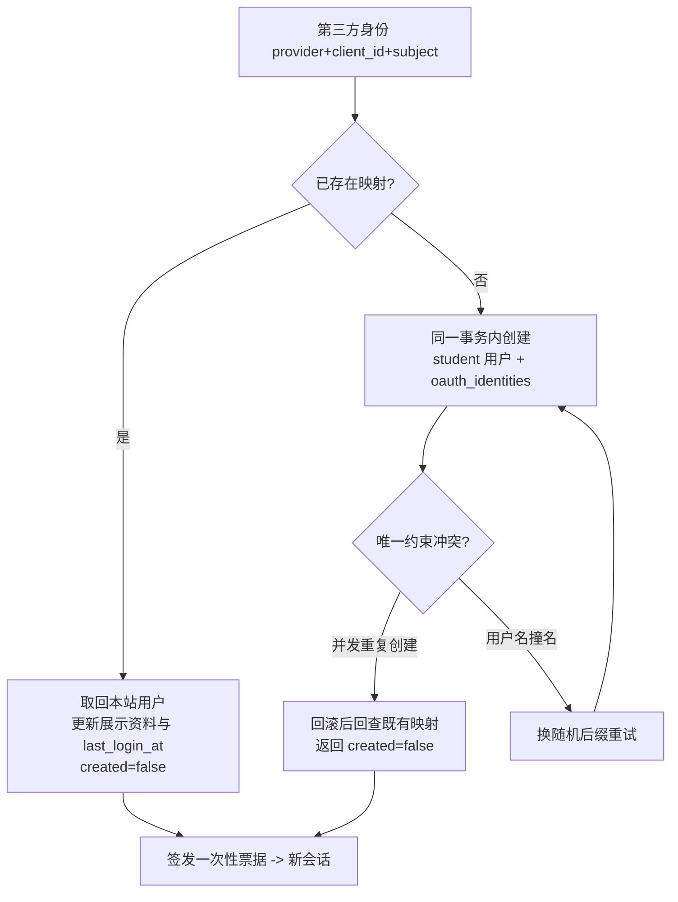
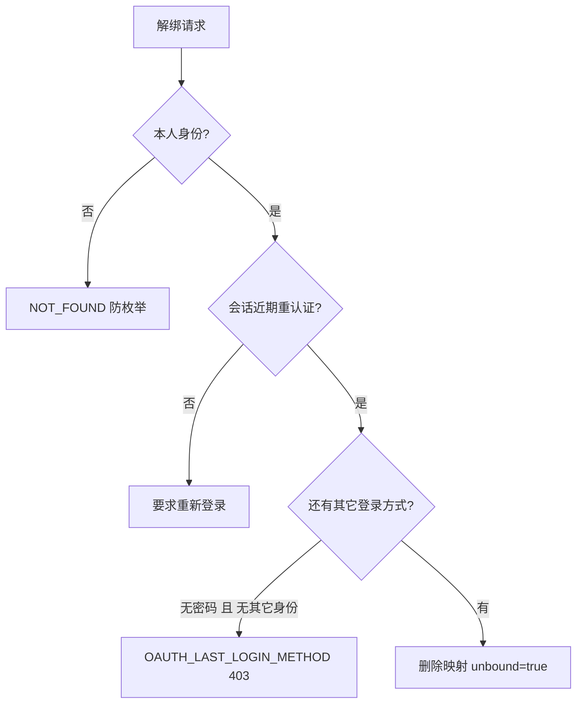

# 账号绑定、解绑与合并纪律（Phase8-A / M4）

## 1. 账号关联的唯一依据

```text
唯一键 = (provider, client_id, subject)
```

* `provider`：wechat / qq / weibo；
* `client_id`：应用标识（不同 AppID 的 OpenID 语义不同，必须隔离）；
* `subject`：平台服务端核验的稳定标识（微信 `openid` / QQ `openid` / 微博 `uid`）。

**禁止**用于识别或关联账号的字段：昵称、头像、邮箱、性别、生日、
任何可变或可重复的展示字段。

## 2. 第三方登录时的账号解析（`resolve_or_create_user`）



要点：

* 建用户与写映射在**同一数据库事务**，不允许「有用户没映射」的孤儿账号；
* `password_hash = NULL`、`role = student`、`status = active`、`email = NULL`；
* `username = {provider前缀}_{8位随机}`（如 `qq_a1b2c3d4`），
  **不用第三方昵称当 username**；
* 并发重复登录同一身份只产生一个本地账号
  （`test_oauth_duplicate_concurrent_register`、E2E `E13-2`）。

## 3. 明确禁止的合并场景（负向测试全覆盖）

| 场景 | 处理 | 负向测试 |
|---|---|---|
| 微信昵称 == 本站用户名 | 不合并，创建独立账号 | `test_oauth_login_does_not_merge_by_nickname` |
| QQ 昵称 == 微信昵称 | 不合并 | `test_oauth_no_cross_provider_merge_by_display_name` |
| 微博邮箱 == 本站邮箱 | 不合并（未核验邮箱不参与识别） | `test_oauth_no_auto_merge_by_email` |
| 头像 URL 相同 | 不合并 | `test_oauth_no_auto_merge_by_avatar` |
| 未核验邮箱 == 已验证邮箱 | 不视为同一账号 | 同上 |

> **重要**：OAuth 登录**绝不会**根据昵称、头像或邮箱自动关联到既有账号。
> 需要合并时，用户必须用原账号登录后**主动绑定**第三方身份（第 4 节）。

## 4. 主动绑定（已登录用户）

* 入口：设置页「第三方账号绑定」→ `POST /auth/oauth/start (mode=bind)`；
* 发起时记录 `initiator_user_id` + `initiator_session_digest`（当前 Bearer 摘要）；
* 完成时校验：**同一用户 + 同一会话**，否则 `OAUTH_SESSION_CHANGED`（绑定取消），
  防止「登录态切换后把别人的第三方账号错绑到自己」；
* 绑定冲突（该第三方身份已绑他人）→ `OAUTH_IDENTITY_CONFLICT`（409），
  **不静默转移**、不静默合并；
* 同一本站账号在同一平台最多绑定 1 个身份，超出需先解绑
  （`OAUTH_IDENTITY_CONFLICT`）；不同平台可各绑一个。

## 5. 解绑与最后登录方式保护

解绑要求：

1. 只能解绑本人身份（他人 identity 返回 `NOT_FOUND`，防枚举）；
2. 会话需在**近期重新认证**窗口内（默认 30 分钟，`require_recent_session`），
   不依赖长期未刷新的旧登录态；
3. **最后登录方式保护**：若解绑后账号将失去全部登录方式
   （`password_hash` 为空 且 无其它第三方身份）→ 403 `OAUTH_LAST_LOGIN_METHOD`，
   提示先设置密码或绑定其它方式。



浏览器 E2E `E14-3` / `E14-4` 覆盖：纯 OAuth 账号解绑被拒 → 补设密码后可解绑 →
密码登录可用（账号不被锁死）。

## 6. 纯 OAuth 账号补设密码

`POST /api/v1/auth/oauth/set-password`：

* 仅当账号尚无密码时走该接口（前端据此展示「设置本站密码」表单）；
* 要求当前有效登录态；
* 成功后除当前设备外的会话全部撤销（`revoked_sessions` 返回数量）；
* 设密后可正常使用密码登录（原有 `user_id`、简历、画像、推荐记录全部不变）。

## 7. 平台账号异常

| 异常 | 处理 |
|---|---|
| 用户注销第三方账号 | 本站映射保留，再次登录时平台不返回身份 → 明确错误；用户可在设置页解绑 |
| 第三方账号被封禁 | 同上（平台侧 error → `OAUTH_PROVIDER_UNAVAILABLE` / `OAUTH_TOKEN_EXCHANGE_FAILED`） |
| 第三方账号换绑手机号 | `subject` 不变（openid/uid 稳定），本站关联不受影响 |
| 平台资料读取失败 | 身份仍有效（UID 已核验），昵称/头像置空，**不产生错误关联**（E2E `E13-5`） |
| 身份串号（前后 subject 不一致） | 阻断（`OAUTH_INVALID_IDENTITY`），绝不关联 |

## 8. 用户可见文案

| 场景 | 文案 |
|---|---|
| 绑定成功 | 第三方账号绑定成功 |
| 重复绑定同一身份 | 该第三方账号此前已绑定，无需重复绑定 |
| 身份已被他人绑定 | 该第三方账号已绑定其他本站账号 |
| 会话变化 | 登录状态已变化，绑定已取消，请重新登录后再绑定 |
| 最后登录方式 | 该身份是账号唯一登录方式，请先设置本站密码或绑定其它登录方式后再解绑 |
| 用户取消授权 | 你已取消第三方授权 |
| 平台异常 | 第三方登录未完成，请重试（附 reason code，绝不显示「密码错误」） |
