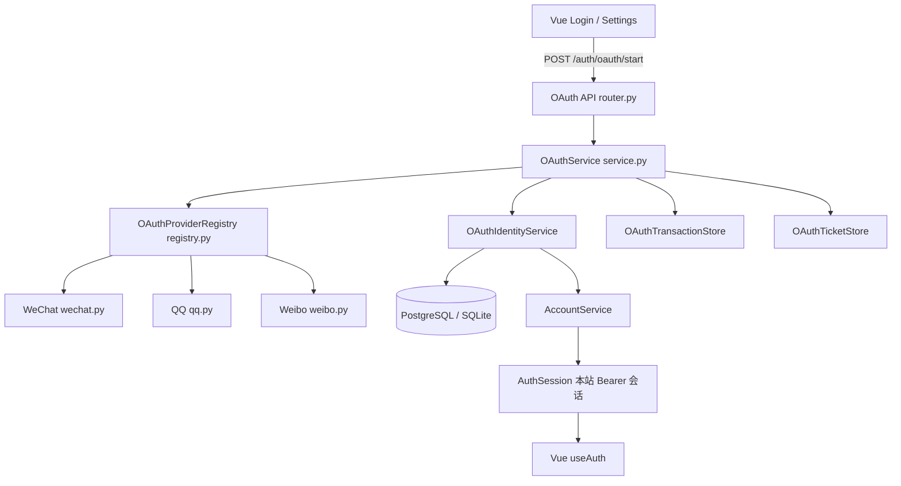
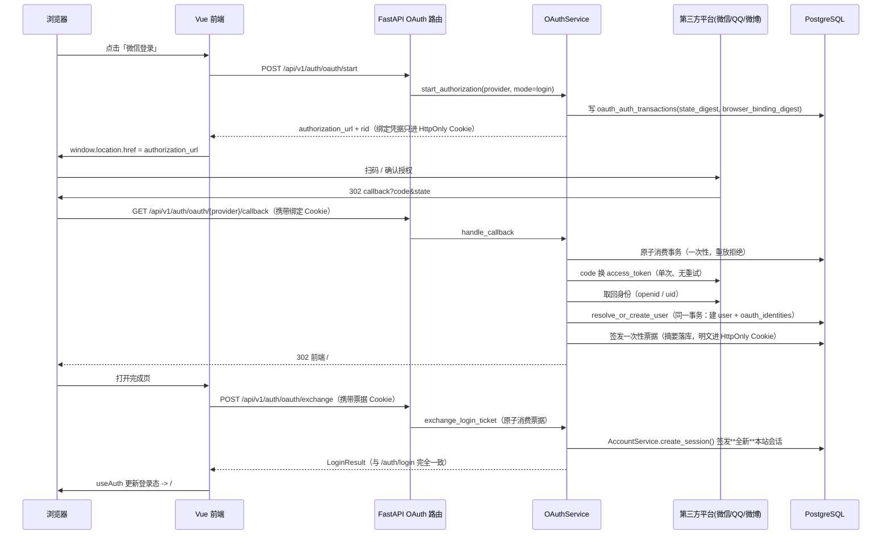
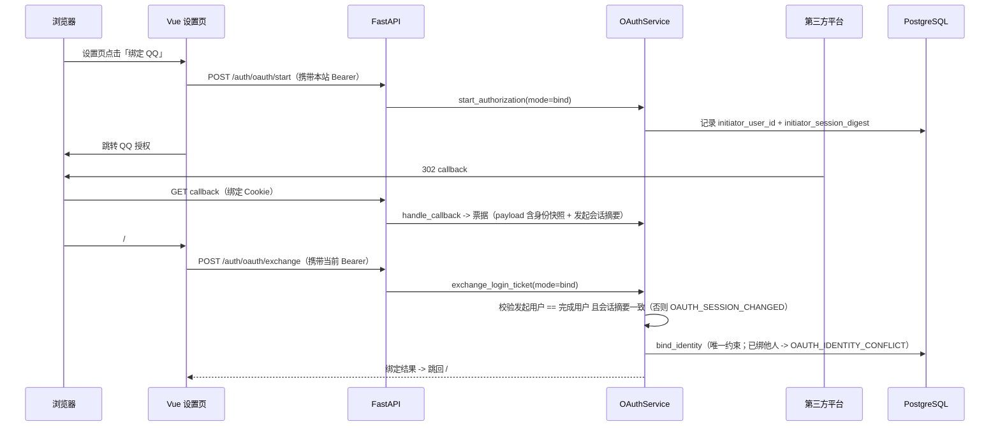
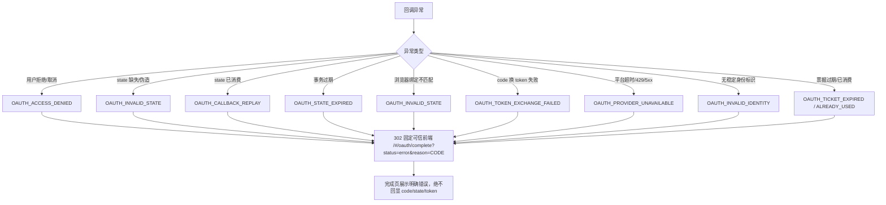
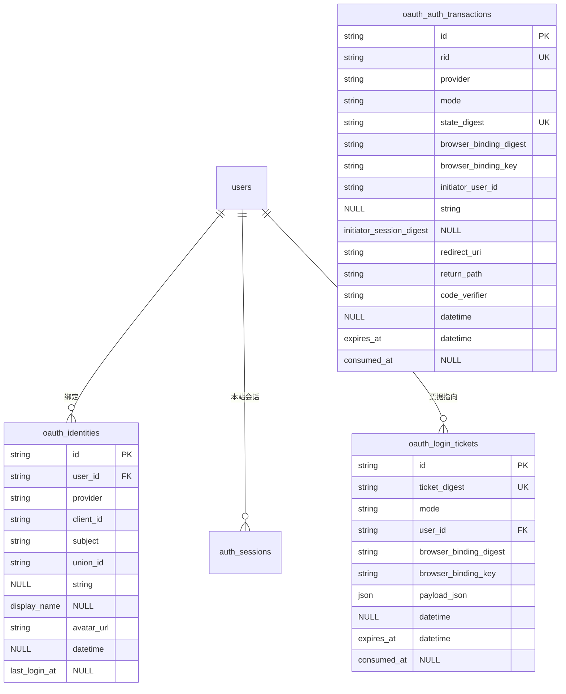

# 统一 OAuth 架构（Phase8-A）

## 1. 分层总览

依赖方向自上而下，**业务层不感知平台差异**：

* `service.py` / `identity_service.py` 中不存在 `if provider == "wechat"`；
* QQ 的 JSONP、微信的 `openid` 字段名、微博的 `uid` 来源全部封装在 `providers/`；
* 业务层只认 `OAuthIdentity(provider, client_id, subject, ...)` 与 `OAuthTokenResponse`。

## 2. 关键模块职责

| 模块 | 职责 | 不做什么 |
|---|---|---|
| `config.py` | 唯一配置入口（环境变量 -> `OAuthSettings`），回调地址解析与安全门禁 | 业务方法内不读写 `os.environ` |
| `registry.py` | Provider 白名单注册、状态查询（disabled / pending / available） | 不接受任意 Provider 名或动态端点（SSRF 防线） |
| `providers/*` | 授权 URL 构建、code 换 token、身份取回与错误映射 | 不做账号关联决策 |
| `transaction_store.py` | 授权事务（state 摘要、浏览器绑定摘要、TTL、一次性消费） | 不存 state 明文 |
| `ticket_store.py` | 一次性登录票据（256 位熵、摘要存储、原子消费） | 不做长期凭据 |
| `identity_service.py` | 身份解析/建号/绑定/解绑、合并纪律 | 不按昵称/头像/邮箱识别账号 |
| `security.py` | state/摘要/Cookie 指令/return_path 白名单/PKCE | — |
| `http_client.py` | 受约束 httpx（超时、限体、零重试、不跟随跳转、可注入 Transport） | 不做无条件重试 |
| `router.py` | HTTP 契约、限流、固定可信跳转 | 不把 code/state/token 带到前端 URL |

## 3. 第三方登录时序

**事务提交顺序**：`users` 与 `oauth_identities` 在同一数据库事务内
（`identity_service._create_user_with_identity`），要么同时成功、要么整体回滚，
不存在「有用户没映射」的孤儿账号；并发重复创建由唯一约束兜底并回查既有映射。

## 4. 账号绑定时序（已登录用户主动绑定）

## 5. 异常流程

所有错误路径都跳**固定可信**前端地址（`JM_OAUTH_FRONTEND_ORIGIN` 首个 Origin +
`/#/oauth/complete`），URL 上只携带 `rid / mode / status / reason / return_path`
等非秘密信息。

## 6. ER 图

详见 [database-schema.md](database-schema.md)。

## 7. 三种 Token 严格隔离

| 名称 | 生命期 | 存放 | 用途 |
|---|---|---|---|
| Provider Access Token | 单次登录内 | 仅服务端内存 | 取回第三方身份；不进浏览器/URL/日志，用完即弃 |
| OAuth 一次性登录票据 | 30–60 秒 | HttpOnly Cookie + DB 摘要 | 回调后换本站会话；一次性、原子消费 |
| 本站 AuthSession Bearer | 既有会话周期 | localStorage（现状，沿用 `useAuth`） | 现有业务 API 鉴权 |

> 当前 `useAuth` 沿用 localStorage 存 Bearer Token（保持全部旧业务兼容）。
> 其 XSS 暴露风险已在安全模型中登记，改 HttpOnly Cookie Session 属独立安全阶段，
> 不在 OAuth 基础设施任务中突然重写。

## 8. 反依赖约束（可自动检查）

* `src/job_matching/service/oauth/service.py`、`identity_service.py`、
  `identity_repository.py`、`ticket_store.py`、`transaction_store.py`
  不得 import 具体 Provider，不得出现平台名分支；
* `providers/` 内端点是**受控常量**，禁止由请求侧传入 URL；
* 测试专用 Fake Provider 只存在于 `tests/` 下，生产代码不 import，
  也没有任何请求参数 / 环境变量能打开 Fake Provider。
