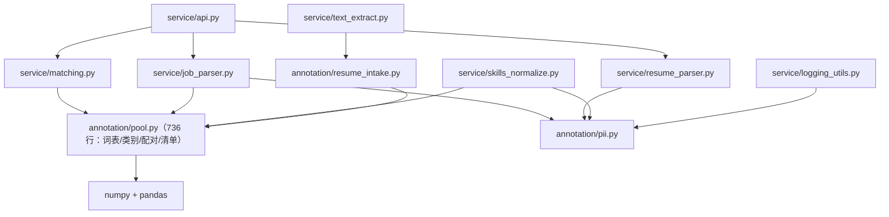
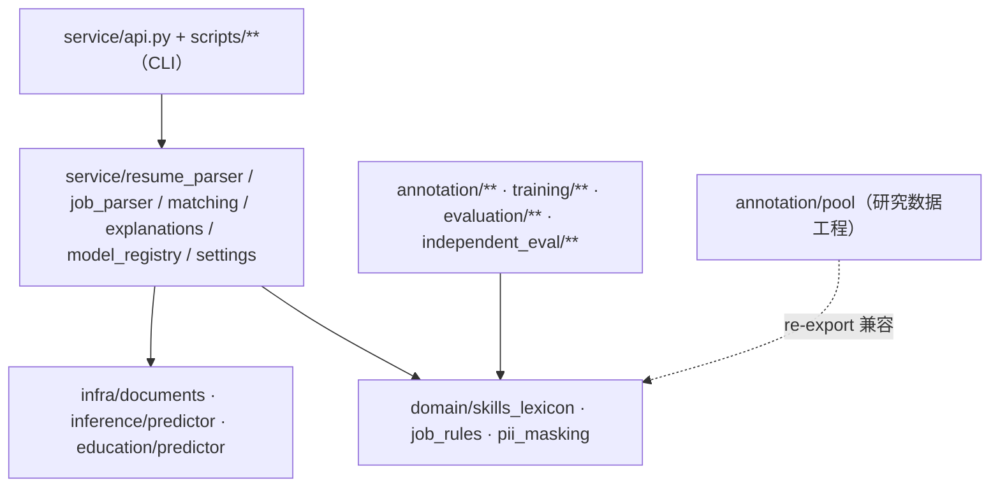

# Phase5-1A 架构审计报告（architecture-audit）

- 审计基线：`0225fcb91a17feec486afb81ae4de3d0e44b342d`
- 审计日期：2026-10-29
- 详细证据：`docs/architecture/phase5-1a-current-state.md`（现状审计全文）、
  `reports/phase5-1a/dependency-graph.{json,md}`（实测导入图）、
  `reports/phase5-1a/runtime-deps.json`（隔离进程实测三方库加载）

## 1. 审计方法

1. 静态导入图：`scripts/phase5_1a/depgraph.py` 遍历 `src/job_matching/**`
   的 AST 导入并解析相对导入，产出模块级依赖边（不是猜测，是解析结果）；
2. 运行时探针：隔离子进程导入业务模块后统计 `sys.modules` 中的重型三方库；
3. 手工核查：职责边界、重复实现、配置散布、异常处理、测试对内部实现的依赖。

## 2. 重构前核心问题（按优先级）

| # | 问题 | 影响 | 处置 |
|---|---|---|---|
| P-01 | 测试运行器按类名前缀分组，R5/R6 被归为 R9/R?，正式分组只汇总 R1–R4 | 测试报告不可信 | P0 已修复（Batch A） |
| P-02 | 执行 0 项测试仍可返回成功 | 假 PASS | P0 已修复 |
| P-03 | 部分组运行覆盖正式全量报告 | 历史报告被污染 | P0 已修复 |
| P-04 | 报告无聚合一致性校验、无环境/commit 元信息 | 结果与报告不一致不可发现 | P0 已修复 |
| P-05 | service 层 6 处导入研究标注层（matching/job_parser/skills_normalize/resume_parser/logging_utils/text_extract → annotation.pool/pii/resume_intake），连带把 numpy+pandas 拖进业务 API | 分层混乱、研究改动波及业务 | P1 已修复（Batch B） |
| P-06 | 技能边界匹配两处实现（`annotation/pool._SKILL_RES`、`service/skills_normalize._boundary_regex`） | Java/JavaScript 等判定口径漂移风险 | P1 已修复（统一 `domain.skills_lexicon.boundary_regex`） |
| P-07 | PII 能力在研究层；"掩码"与"匿名化"口径未区分 | 隐私表述风险 | P1 已修复（`domain/pii_masking` + 口径文档） |
| P-08 | 运行参数散落常量，无类型化配置 | 部署/测试替换困难 | P1 已修复（`service/settings.py`） |
| P-09 | 模型加载失败分类过粗（旧 sklearn 反序列化失败被归"损坏"） | A4 无法准确登记 | P1 已修复（三分类 + `MODEL_ENV_INCOMPATIBLE`） |
| P-10 | `verify_freeze()` 只校验清单列出的文件哈希 | manifest 自身被改写不可发现 | P1 已补独立只读检查器（不改冻结模块） |
| P-11 | `environment.yml` 未声明服务依赖 | 服务不可复现 | P1 已补三份清单 |
| P-12 | 无 CI | 无自动化门禁 | P2 已补 `.github/workflows/quality-gates.yml` |
| P-13 | `reports/phase5-1r/` 缺 acceptance / defect-register / fix-summary | 交付闭环缺口 | P2 已补（真实证据生成） |

## 3. 重构前依赖图（简化）

问题本质：`annotation/pool.py` 同时承载研究数据工程与纯业务规则，
业务运行时被迫依赖研究标注层与其重依赖（pandas）。

## 4. 重构后依赖图（实测）

实测结果（`dependency-graph.md`）：**service → annotation 的跨层边为 0**；
`import job_matching.service.api` 的隔离进程探针输出 `HEAVY=`（pandas/torch/sklearn 均不加载）。

## 5. 运行时依赖结论

- 重构前：`import service.api` 实测加载 numpy + **pandas** + pydantic + yaml
  （pandas 全部来自 `annotation.pool` 导入链）；
- 重构后：pandas 只出现在研究层与训练特征路径
  （`annotation.pool`、`annotation.freeze`、`training.feature_map` 等）；
- torch / sklearn 从来不在导入期加载（模型惰性加载），GPU 不是业务 API 必要条件。

## 6. 审计中确认"暂不实施"的项

见 `docs/architecture/phase5-1a-current-state.md` §4：service→application 重命名、
每函数 Protocol、FastAPI Lifespan 重写、两种经验解析合并、测试迁移 pytest、
重训旧 checkpoint——均记录为暂不实施并给出理由。
