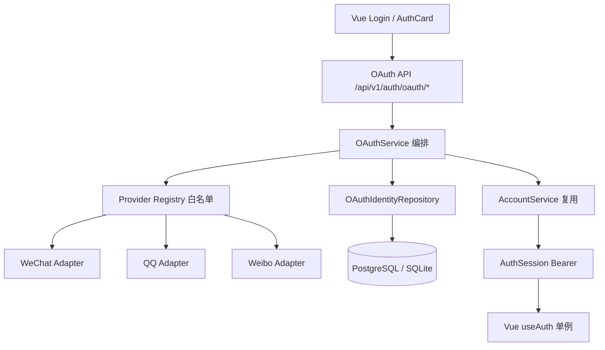

# Phase8-A 最终验收报告（phase8-a-final-acceptance）

- 生成时间：2026-11-01
- 分支：`feat/phase8a-unified-oauth`
- HEAD：`12e03639b663908a7da9333dd35839dd73658ba2`
- 目标：统一 OAuth 2.0 认证架构 + 微信 / QQ / 微博三平台接入基础设施，
  真实凭据到位后**只配置、审核与联调，不改业务源码**。

---

## 1. 总体评级（诚实口径）

```text
A. Unified OAuth Infrastructure   : PASS   统一 Provider 抽象 / 注册表 / 事务 / 票据 / 身份映射 / API / 前端
B. Provider Adapter Ready         : PASS   微信 / QQ / 微博适配器可执行实现 + 模拟响应协议测试
C. Mock Integration Passed        : PASS   单测 + API 集成 + SQLite + PostgreSQL + 浏览器 E2E 全绿
D. Real Provider Verified         : NOT_RUN 无真实 AppID / AppSecret / 审核通过的回调域名

WeChat Adapter (Mock)             : PASS
QQ Adapter (Mock)                 : PASS
Weibo Adapter (Mock)              : PASS
Real WeChat OAuth                 : NOT_RUN
Real QQ OAuth                     : NOT_RUN
Real Weibo OAuth                  : NOT_RUN
```

> **A/B/C 全部成功，但 D 保持 `NOT_RUN`。** 真实微信 / QQ / 微博授权登录尚未执行
> （无开发者凭据与平台审核回调域名）。Mock 全链路通过**不冒充**真实平台授权成功。

---

## 2. 里程碑逐项验收（M0–M12）

| 里程碑 | 交付 | 结论 | 证据 |
|---|---|---|---|
| M0 审计 | 现有认证链路 / 数据库 / 前端登录态 / Token 生命周期 / 路由 / 配置 / 最小变更范围 / 15 项安全风险 / 兼容性约束 | PASS | `00-existing-auth-audit.md` |
| M1 Provider 抽象 | `OAuthProvider` 协议 / `OAuthIdentity` / `OAuthProviderRegistry`（白名单） | PASS | `01-provider-abstraction.md` |
| M2 三平台适配器 | wechat / qq / weibo 完整实现 + 协议测试（39 例） | PASS | `02-provider-adapters.md` |
| M3 数据库迁移 | Alembic `e8a0f1c2d3a4`：三表 + `password_hash` 可空，SQLite/PG 实测 | PASS | `03-database-migration.md` |
| M4 业务编排 | start / callback / resolve_or_create / bind / exchange / list / unbind | PASS | `04-oauth-service-contracts.md` |
| M5 安全基线 | state/CSRF/PKCE/票据/Token 隔离/Session Fixation/限流/日志（28 项负向测试） | PASS | `05-security-validation.md` |
| M6 API 契约 | `/api/v1/auth/oauth/*` 复用统一信封与错误码体系 | PASS | `docs/oauth/api-contracts.md` |
| M7 前端集成 | 三平台按钮接真实入口 + 完成页 + 绑定区 | PASS | `06-frontend-integration.md` |
| M8 配置注入 | `.env.example` + `ServiceSettings` + `oauth doctor`，无凭据安全禁用 | PASS | `docs/oauth/environment-configuration.md` |
| M9 测试体系 | Fake Provider 全链路：单测 + API 集成 + PG 集成（144 例） | PASS | `07-provider-mock-tests.md` |
| M10 CI/回归 | `phase8-oauth-gates` + 既有门禁不破坏 | PASS | `08-ci-regression.md` |
| M11 凭据接入 | 零代码接入手册 + 真实联调状态 `NOT_RUN` | PASS | `CREDENTIALS-INTEGRATION.md`、`09-credentials-readiness.md` |
| M12 文档体系 | `docs/oauth/` 13 份 + `reports/phase8-a/` 阶段报告 | PASS | 本目录 |

---

## 3. 实现结果

- **统一 Provider 抽象**：`OAuthProvider` 协议 + `OAuthIdentity`（provider/client_id/subject
  命名空间化）+ `OAuthProviderRegistry` 白名单（wechat/qq/weibo），业务层零 `if provider == ...`。
- **微信 Adapter**：`qrconnect` 扫码 + `snsapi_login`，openid/unionid(errcode/errmsg)。
- **QQ Adapter**：authorize/token/me/get_user_info，`fmt=json` 优先 + JSONP 安全解析（无 eval）。
- **微博 Adapter**：OAuth2 authorize/access_token，UID 获取，资料失败仍以 UID 完成登录由契约控制。
- **PostgreSQL Migration**：`oauth_identities`（UNIQUE provider+client_id+subject）、
  `oauth_auth_transactions`、`oauth_login_tickets` + `users.password_hash` 可空，upgrade/downgrade 完整。
- **OAuth 登录**：start→授权→callback→换身份→建号/关联→一次性票据→exchange→复用 `create_session()`。
- **账号绑定**：已登录主动绑定，防抢绑 / 会话漂移 / 并发重复身份。
- **解绑**：仅所有者可解绑，最后登录方式保护（`OAUTH_LAST_LOGIN_METHOD`）。
- **前端**：`AuthCard.vue` 三按钮接真实 API + `/#/oauth/complete` 完成页 + `SettingsView.vue` 绑定区；
  纯 OAuth 用户「设置本站密码」入口；登录态仍归 `useAuth`（无并行全局登录态）。
- **配置系统**：`.env.example` 三平台凭据占位 + `ServiceSettings` 注入 + `scripts/phase8a/oauth_doctor.py`。
- **安全测试**：state/CSRF/重放/票据/开放重定向/Token 泄露/Session Fixation/限流 全部负向覆盖。

---

## 4. 测试结果汇总

| 维度 | 结果 | 明细 |
|---|---|---|
| OAuth 单测数量 | **144** | 安全原语 14 + Provider 协议 39 + 事务票据 17 + 身份纪律 19 + API 集成 49 + PG 集成 6 |
| SQLite | PASS | 全部 OAuth 套件在临时 SQLite（Alembic 迁移建库）通过 |
| PostgreSQL | PASS | `JM_TEST_DATABASE_URL_POSTGRES` 提供时真实执行并全绿 |
| FastAPI（API 集成） | PASS | start→callback→exchange→/auth/me→logout→旧 Token 401 |
| Vue（typecheck + build） | PASS | `vue-tsc --noEmit` + `vite build` |
| Playwright（E01–E15） | PASS | 35/35（OAuth 专项 E13–E15 共 18 例） |
| core-ci | PASS | 87/87 |
| phase5-2 / 5-2R / 6 / 7 | PASS | 62 / 70 / 81 / 74（SKIP 为既有条件跳过） |
| GitHub Actions | 待远端验证 | `phase8-oauth-gates` 已就位，本地全绿；远端 Run URL 待 push 后登记 |
| 真实平台联调 | **NOT_RUN** | 无凭据，禁止假 PASS |

状态口径：`PASS`（真实执行通过）/ `NOT_RUN`（无凭据，未执行）。无 `FAIL` / 无 `SKIP` 冒充。

---

## 5. 等待用户提供的内容（只登记字段与状态，不打印任何真实 Secret）

### 微信开放平台

```text
Provider:        微信开放平台（网站应用 / PC 扫码）
AppID:           未提供（填 JM_OAUTH_WECHAT_CLIENT_ID）
AppSecret:       未提供（填 JM_OAUTH_WECHAT_CLIENT_SECRET，仅服务端）
审核状态:         PENDING（未申请）
回调域名:         PENDING（需与 JM_OAUTH_PUBLIC_BASE_URL 域名一致）
授权 Scope:       snsapi_login
权限状态:         PENDING
真实联调状态:      NOT_RUN
```

### QQ 互联

```text
Provider:        QQ 互联（网站应用）
AppID:           未提供（填 JM_OAUTH_QQ_CLIENT_ID）
AppSecret:       未提供（填 JM_OAUTH_QQ_CLIENT_SECRET，仅服务端）
审核状态:         PENDING（未申请）
回调域名:         PENDING（完整回调 URL 必须逐字符一致）
授权 Scope:       get_user_info
权限状态:         PENDING
真实联调状态:      NOT_RUN
```

### 微博开放平台

```text
Provider:        微博开放平台（网站接入）
AppID:           未提供（填 JM_OAUTH_WEIBO_CLIENT_ID，App Key）
AppSecret:       未提供（填 JM_OAUTH_WEIBO_CLIENT_SECRET，仅服务端）
审核状态:         PENDING（未申请）
回调域名:         PENDING（OAuth2.0 授权设置内配置）
授权 Scope:       基础登录接口
权限状态:         PENDING（资料接口权限随资质变化）
真实联调状态:      NOT_RUN
```

凭据到位后的零代码接入步骤见 `docs/oauth/CREDENTIALS-INTEGRATION.md`（12 步 PowerShell 操作包）。

---

## 6. 总体架构（Mermaid）



登录 / 绑定时序图、异常流程图、ER 图见 `docs/oauth/architecture.md` 与 `database-schema.md`。

---

## 7. 遗留与安全登记

- **`useAuth` localStorage Token 存在 XSS 暴露面**：本轮保持既有存储行为（避免破坏旧业务），
  转 HttpOnly Cookie Session 作为**独立安全阶段**实施，已在 `05-security-validation.md` 登记。
- **PROVIDER_VERIFICATION_PENDING**：微信 UnionID 机制 / QQ JSONP 触发条件 / 微博资料接口权限
  随平台资质变化，联调时复核，不虚构字段。
- **生产启用前置**：HTTPS + 备案回调域名 + 平台审核通过，缺一由 `oauth doctor` / `check_safety()` 拒绝启用。

---

## 8. 最终结论

统一 OAuth 2.0 认证架构与三平台接入基础设施**全部就绪**（Framework / Adapter / Mock Integration
三层 PASS），真实平台联调因**无开发者凭据**如实登记 `NOT_RUN`。开发者明日拿到三家 AppID/AppSecret 后，
按 `docs/oauth/CREDENTIALS-INTEGRATION.md` 仅做配置与平台侧登记即可完成真实接入，**无需重构业务代码**。
